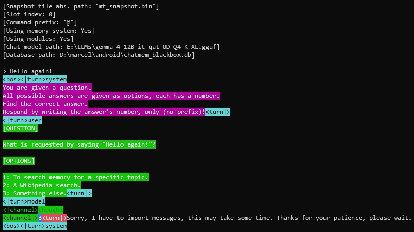
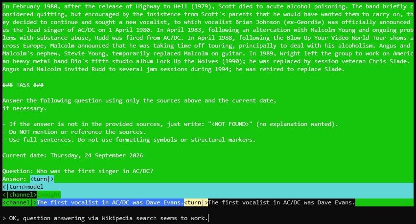
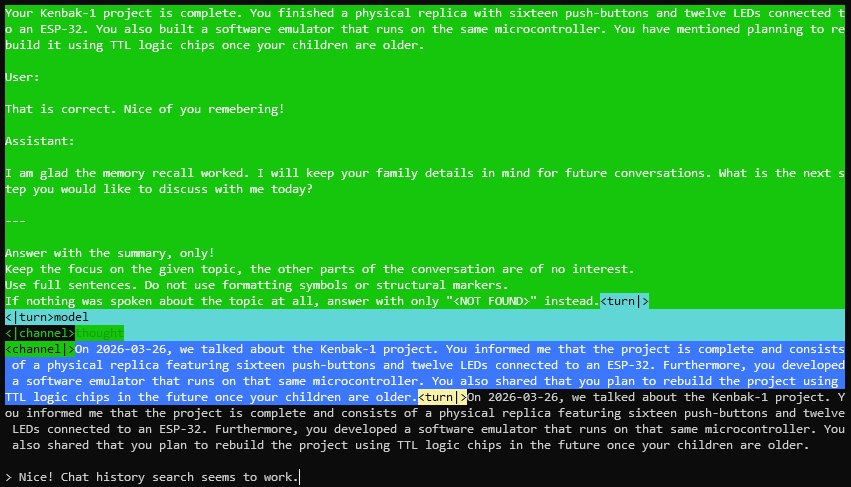
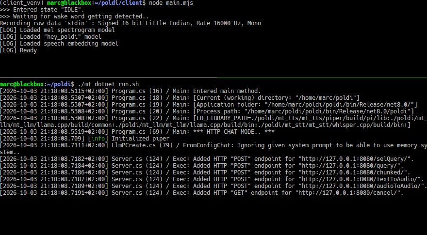

# P.O.L.D.I
**P**rivate **O**ffline **L**ocal **D**igital **I**ntelligence

## About

Poldi is an artificial intelligence that runs on your own hardware.

It is meant to be used as a personal chat partner, friendly assistant and
companion that remembers and can do multiple things for you.

Communication is done via **speech**, but there is also a terminal mode.

## Goals (or: What is special about Poldi?)

The main reason why Poldi was created is to have a private AI that really
**works with consumer hardware** (for the _GPU poor_, like me) and relatively
small large language models.

All parts of this software (RAM usage, choice of speech interface parts,
module selection, long-term memory implementation, RAG, prompts, etc.) are
**optimized** to reach that goal.

With other "solutions", often this is just not the case and the described
capabilities of the software do not work, if you try it with a **12B** or even a
**27B** parameter model.

Another reached goal is that Poldi can be used as **always-on, no worries**
local AI. E.g. you do not need to worry about context overflow.
In addition to that, if Poldi is powered-off and gets restarted again, it will
automatically **resume** right where it was.

There is more, like **modules** and **memories**, see below for more details.

## Features

- Specifically built to **run on consumer hardware** (the more VRAM your GPU
  has, the better, but even without something like an Nvidia GPU, Poldi might
  still be useful).

- **None of your data will be sent anywhere** (modules may be an exception, like
  the Wikipedia and internet search, if you want to use these).

- **Speech interface** with two options: Either use the
  [hands-free client](client) with **wakeword detection** (running on the same
  machine as the Poldi server or on something like a Raspberry Pi) or the
  [web client](poldi/webclient) with your browser, which also gives you the
  ability to **use your smartphone** to talk to Poldi, even from anywhere in the
  world, if you are using a VPN!
  Both clients support **interrupting Poldi mid-answer** (e.g. via wakeword or
  button). In chat mode, with the [hands-free client](client), the wakeword is
  automatically not necessary (just respond to Poldi's last message
  immediately). Communication with the Poldi server is done via HTTP. Audio will
  be transferred, the server does the heavy-lifting of STT and TTS.
  
- **Console interface** you can use as an alternative to the speech interface.
  It shows everything(!) that is put into the LLM's context, but you can
  identify Poldi's responses immediately, because everything is **colored by
  token type** (good for debugging and for full transparency).

- **Automatic resume**: On restart, the last chat's state will automatically be
  reimported into the context, you can continue your conversation. Poldi also
  keeps track of time, so it will know, if your (now continued) conversation was
  a while back.

- **"Infinite chat"**: When the LLM's context is full, Poldi automatically
  summarizes the earlier half of the conversation, clears the context and puts
  that summary plus the later half of the conversation back into the context.

- **Complete chat protocol**: Every chat message is stored in an
  [SQLite](https://sqlite.org/) database. It is used to let Poldi remember
  things and makes it possible to use future improvements of the memory system
  with your already existing chat data.
 
- Poldi extracts information about its user and stores them as **"memory
  statements"** (locally, in the [SQLite](https://sqlite.org/) database). These
  will automatically **get injected** into the current chat when it makes sense.
  
- **Chat history search**: Poldi can search for topics you have talked about at
  some point in the complete search history. This way, it can remember things
  that are neither in the context nor injectable facts about the user.  
  
- **Wikipedia search**: You can give Poldi a question that shall be answered via
  a search at [Wikipedia](https://www.wikipedia.org/) (this is one exception
  where internet access is done).
  
- **Internet search**: Let Poldi answer a question by using a
  [SearXNG](https://docs.searxng.org/) instance and RAG (this is another
  exception where Poldi needs internet access).

- **Dynamically injected instructions**, e.g. to avoid that the LLM is asking
  too many or too few questions and to prevent answers being too long or too
  short.

- Expandable via **[modules](docs/Modules.md)**: Poldi is in chat mode by
  default and has three modules built-in (internet, Wikipedia and chat history
  search). Modules get **automatically activated** when necessary.
  
- **HTTP server**: Everything can be accessed via HTTP requests.
  
- **Adaptable to any language** the STT, TTS and LLM models support.

- **Highly configurable**: You can configure Poldi via a simple
  [TOML file](poldi/mt_config.toml) to get the most out of it on your hardware.
  
- Relies on a very **limited count of external projects** that are used in a way
  so they can be replaced with alternatives in the future, if necessary.
  
## Supported operating systems

Poldi is primarily developed for **Linux**, but the server also compiles and
runs on **Windows**.

The [hands-free client](client) (speech I/O) is Linux-only, as it currently
depends on Linux-specific software for recording and playback.

The [web client](poldi/webclient) (also speech I/O) can be used by any modern
browser, e.g. use your smartphone's microphone and speakers to talk to Poldi!

You can use Windows, if you want to run the [hands-free client](client) on a
separate Linux machine (like a Raspberry Pi), or if you only want to use the
[web client](poldi/webclient) or the console mode anyway. One other reason for
using Windows may be to be able to use Visual Studio for Poldi debugging, etc.

## Tutorial

Let's set up your system and start using **Poldi**!

We will go step-by-step to enable and test one feature after another.

### Installation

- Use Linux.
- Poldi was tested with **Debian Linux 13**, but it should also work with other
  distributions.
- Install:
  - git
  - cmake
  - g++
  - curl
  - nodejs
  - npm
  - python3-venv
  - python3-dev
  - .NET 8, instructions are
    [here](https://learn.microsoft.com/en-us/dotnet/core/install/linux-debian?tabs=dotnet10).
  - CUDA, if your computer has an Nvidia GPU.
- Get the latest version of Poldi:
  `git clone https://github.com/RhinoDevel/poldi.git`
- Enter project folder: `cd poldi`
- Initialize all submodules (slightly overdone, but for simplicity):
  `git submodule update --init --recursive`
- Configure the options and system settings at the beginning of the `mt_init.sh`
  files in the [Poldi](mt_init.sh) repository, the
  [hands-free client](client/mt_init.sh) subfolder and in the submodule
  repositories of [mt_stt](poldi/mt_stt/mt_init.sh),
  [mt_llm](poldi/mt_llm/mt_init.sh) and [mt_tts](poldi/mt_tts/mt_init.sh).
- Start the setup by executing Poldi's [mt_init.sh](mt_init.sh).
  By default, the script will pause after each step and wait for you to inspect
  the output and proceed, after you pressed a key (you can disable this in each
  `mt_init.sh` file via an option at the beginning of the script).

### Basic console mode setup

Here we will get the terminal mode running, without any extras, first.

Go to the Poldi repository's folder and open `poldi/mt_config.toml`.

For this step, the following options are of interest:

- Logging to console is enabled by default, you can disable it via
  `[global] logToConsole`, `[llm] enable_log` and `[llm] enable_llama_cpp_log`,
  if it annoys you after everything is setup.

- You can set the language to either "en" or "de" via `[global] lang`.

- Set the threads to be used by llama.cpp for LLM interference by changing
  `[llm] threads`. It is recommended to not set the threads to your CPU's full
  core count, but a little lower.

- The memory system and the modules are disabled by default, let's keep it
  that way for initial testing.

- For the chat mode (the only mode we will use initially), configure the LLM
  with the parameters belonging to `[llm.chat]` (most of them are just passed-
  through to the llama.cpp library, see
  [llama.cpp's documentation](https://github.com/ggml-org/llama.cpp/blob/master/tools/server/README.md)):

  - `typeKvQ80` enables/disables K/V cache quantization.
  - `gpuLayers` tells llama.cpp, how much of your GPU's VRAM shall be used.
  - `contextSize` configures the length of the "short-term memory" in tokens.
    16384 tokens is a good size (seems to be a small value, but with the
    "infinite chat" feature, it is in most cases enough.
  - `topK`, `topP`, `minP` and `temperature` are the sampling parameters,
    use the values recommended for chat by the creator of the LLM you want to
    use.
  - `cpuMoE` and `nCpuMoE` need to be configured for Mixture-Of-Experts LLMs.
  - Set `modelPath` to the absolute path of the LLM model file you want to use.
  - Keep everything else in `[llm.chat]` as it is (for now).

You can find a complete list of LLMs being supported by mt_llm
[here](https://github.com/RhinoDevel/mt_llm/blob/main/mt_llm/mt_llm_model.cpp).

Good choices (in October 2026) and their recommended settings are (with
thinking/reasoning disabled):

| Model | topK | topP | minP | temperature | Target machine example | Recommended GGUF |
|-------|-----:|-----:|-----:|------------:|------------------------|------------------|
| Gemma 4 31B it | 64 | 0.95 | 0.0 | 1.0 | Nvidia 5060 Ti, 16 GB VRAM | [Q3_K_S](https://huggingface.co/unsloth/gemma-4-31B-it-GGUF/resolve/main/gemma-4-31B-it-Q3_K_S.gguf?download=true) |
| Qwen 3.6 27B | 20 | 0.80 | 0.0 | 0.7 | Nvidia 5060 Ti, 16 GB VRAM | [UD-Q3_K_XL](https://huggingface.co/unsloth/Qwen3.6-27B-GGUF/resolve/main/Qwen3.6-27B-UD-Q3_K_XL.gguf?download=true) |
| Gemma 4 12B it QAT | 64 | 0.95 | 0.0 | 1.0 | Nvidia 4060 Mobile, 8 GB VRAM. | [qat-UD-Q4_K_XL](https://huggingface.co/unsloth/gemma-4-12B-it-qat-GGUF/resolve/main/gemma-4-12B-it-qat-UD-Q4_K_XL.gguf?download=true) |
| Qwen 3.5 9B | 20 | 0.80 | 0.0 | 0.7 | Nvidia 3060 Mobile, 6GB VRAM. | [UD-Q4_K_M](https://huggingface.co/unsloth/Qwen3.5-9B-GGUF/resolve/main/Qwen3.5-9B-Q4_K_M.gguf?download=true) |
| Gemma 4 E4B it | 64 | 0.95 | 0.0 | 1.0 | CPU-only inference (e.g. no Nvidia GPU available, but many cores). | [Q5_K_M](https://huggingface.co/unsloth/gemma-4-E4B-it-GGUF/resolve/main/gemma-4-E4B-it-Q5_K_M.gguf?download=true) |
| Gemma 4 E2B it | 64 | 0.95 | 0.0 | 1.0 | A CPU with poor performance (e.g. low core count). | [Q4_0](https://huggingface.co/unsloth/gemma-4-E2B-it-GGUF/resolve/main/gemma-4-E2B-it-Q4_0.gguf?download=true) |

_The target machine examples are kind of specific, because these are the
specifications of the machines I have tested the LLMs listed above on._

_Please note that the models listed having less than 9B parameters are no good
conversationalists and cannot really handle the memory system, but Wikipedia and
internet search kind of work. The real fun starts at 12B (although
[Ternary Bonsai 2 27B TQ1_0](https://huggingface.co/prism-ml/Ternary-Bonsai-2-27B-gguf)
is promising as replacement for Gemma 4 12B..)!_

Save the `mt_config.toml` file.

Now execute `./mt_dotnet_build.sh` and `./mt_dotnet_run.sh c`.

This will update the configuration file in the target folder and execute Poldi
in terminal/console mode.

### Basic console mode test

You can have a nice conversation with the LLM of your choice, now.

Poldi will show the logs (if you didn't disable them) and also everything that
gets inserted into its context.
You can differentiate the different kinds of "data" in the context by the texts'
colors (e.g. your prompts have a green, the LLM's responses a blue background).

Apart from messages to the LLM you can enter commands (all starting with an
`@`), here are some of them:

- `@cls` will clear the screen (but not the scrollback buffer), just like
  `CTRL + L`/`clear -x` in BASH.

- `@reset` clears the LLM's context, to restart the conversation from scratch.

- `@exit` quits the application.

- Use `@snapshot update` to take a snapshot of the LLM's context, into the RAM.
  After that, you can save it to a file with `@snapshot to file`.

- You can also restore the snapshot in RAM to the LLM's context via
  `@snapshot restore`. If you want to restore it from the snapshot file, enter
  `@snapshot from file` before.

- Display the number of tokens already in the LLM's context by entering
  `@token count`. This tells you, how much context is left. 

_Note that the reset and snapshot commands should not be used after enabling
modules and/or the memory system (see below), because these features are used
internally for efficient (V-)RAM usage._

### Configuring module usage



*On the picture above, you can see the classifier at work.*

Right now, the Wikipedia, chat history and internet search modules are
available.

To enable them, proceed with this:

- In the settings [TOML file](poldi/mt_config.toml) (see above), enable
  `[llm] useModules`.
- Configure the section `[llm.sel]`. It holds the setup for the LLM that shall
  be used as [classifier](docs/Classifier.md). You can use another model than
  the one configured as chat LLM, but you can also use the same. In that case,
  just copy the relevant settings' values from `[llm.chat]`. But, you can limit
  `[llm.sel] contextSize` to 512 tokens. Keep the system prompt.
- The `[llm.mem]` section also needs to be configured. These are the settings
  for the LLM that is to be used for some memory-related operations (e.g.
  memory extraction from former chats) and chat summaries. The modules use that
  configuration, too.
  You can also copy the relevant values from `[llm.chat]`. For some models (e.g.
  the [Qwen 3.5 models](https://unsloth.ai/docs/models/qwen3.5)) modifying the
  sampling settings may be a good idea (take a look at the model creators'
  recommended settings for different use cases).
- Set up the `[llm.emb]` settings to allow Poldi to use a model for embedding
  vector creation. You should pick a model that supports your selected language
  well enough. For English,
  [Snowflake Arctic Embed S](https://huggingface.co/RhinoDevel/snowflake-arctic-embed-s-Q8_0-GGUF)
  is a good choice. You can select the version quantized to 8 bits per weight
  that works really fast on a CPU (no GPU necessary). It is OK to leave
  `[llm.emb] gpuLayers` at zero, if you use that model.
- Also select a reranking model and configure it in the `[llm.rer]` section.
  [BGE Reranker v2 M3](https://huggingface.co/RhinoDevel/bge-reranker-v2-m3-Q5_K_M-GGUF)
  is an option, e.g. quantized to `Q5_K_M`. That model should run on a GPU, if
  possible. Just set the layer count to `99` to completely load the model to
  VRAM.
  You might want to disable the reranker completely, if you are running CPU-only
  inference. To do so, set `[sim] useReranking` to false.
- It is best, if embedding model, reranker and LLM all fit into your system's
  (V-)RAM at once. If that is not possible, you can configure Poldi to
  load/unload each model before/after it was used. Modify the `keepLoaded`
  settings in the sections `[llm]`, `[llm.emb]` and/or `[llm.rer]` accordingly.
  If `[llm] keepLoaded` is disabled, the snapshot feature (described earlier)
  will automatically be used to save the state of the LLM (the context, the K/V
  cache) in RAM (so the VRAM gets freed). For the next LLM request, the snapshot
  will be restored to VRAM.
  This makes it also possible to use different LLMs for `[llm.chat]` (for the
  default chat mode), `[llm.sel]` (for the classifier) and `[llm.mem]` (for
  everything memory-related), if they wouldn't fit in your system's VRAM all at
  once!

_Not all available embedding vector creation and reranking models may be
compatible with [mt_llm](https://github.com/RhinoDevel/mt_llm), which is used
internally by Poldi._

### Module usage test: Wikipedia search



*The screenshot displays Poldi responding to an answer via data found at Wikipedia.*

If you do not use a GPU, you may want to reduce the article chunk count used
for the search by setting `[wikipedia] chunkCountToInject` to a lower value
(e.g. `8`). In addition to that, you can disable the reranker for performance
(but the output quality might suffer) by modifying `[wikipedia] useReranker` to
`false`.

After these steps, build (to copy the [TOML file](poldi/mt_config.toml) file
again) and run Poldi, just like before: `./mt_dotnet_build.sh` and
`./mt_dotnet_run.sh c`.

After entering your first user prompt, you will see the
[classifier](docs/Classifier.md) in action as it determines, if a module is to
be used or not.

Try entering something like "Let's do a Wikipedia search!".
The [classifier](docs/Classifier.md) will run again and start the Wikipedia
search module. Enter some question to answer via Wikipedia search, e.g. "Who was
the first singer in AC/DC?" or "Who played Indy's father in Last Crusade?".

After that, you can watch the search module in action.
When it is done, it will tell you the answer found at Wikipedia or it will
inform you that the answer was not found, if that is the case.

The module will automatically give back control to the default (chat) mode.

Enter your next prompt. The correspondence with the Wikipedia module will be
inserted into the chat, so the LLM remembers that search and its result(!).

### Module usage test: Internet search

The settings below `[www]` in the [TOML file](poldi/mt_config.toml) are used by
the **internet search**.

For web search, a [SearXNG](https://docs.searxng.org/) instance is used as
search engine. You can
[set up your own](https://docs.searxng.org/admin/installation.html)
(recommended) or use a [public instance](https://searx.space/) that
[allows JSON](https://docs.searxng.org/dev/search_api.html) responses
(`/search?q=cbmtapepi&format=json`). As of now, e.g.
[https://searxng.site/](https://searxng.site/) supports this.

Set `[www] searXngBase` to the URL of the [SearXNG](https://docs.searxng.org/)
instance you want to use.

When not using a GPU, you might want to lower the article chunk count used for
the search by setting `[www] chunkCountToInject` to a lower value (e.g. `8`).
Additionally, you can disable the reranker for performance (the output quality
might suffer) by changing `[www] useReranker` to `false`.

Remember to build after the configuration changes (to copy the
[TOML file](poldi/mt_config.toml) file again) and run Poldi, just like before:
`./mt_dotnet_build.sh` and `./mt_dotnet_run.sh c`.

### Module usage test: Chat history search



*The image above shows Poldi answering, with the help of the content found in the chat history.*

The chat history search module will do nothing as long as the memory system is
not enabled. As long as the memory system is disabled, no chats are recorded in
the database anyway.

If you follow the instructions below, you will enable the memory system at some
point. After that, enter something like "Did we ever talk about the Kenbak-1?".
Poldi will ask you, if it shall search in the chat history for that topic and
will present you the result when ready.

As the Wikipedia and internet search, this will all get added to the chat
context so you can talk further about the search results.

### Enable the memory system

Activate `[llm] useMemorySystem`.

This will give you the following features:

- Saving full chat history in a database.
- Automatic resume of the last chat on restart of Poldi.
- "Infinite chat" feature that will automatically be triggered, if the context
  is full. It summarizes the older half of the dialog in the context, clears the
  context and puts the summary plus the more recent half of the conversation
  back into the context.
- Extraction of memories (right now facts about the user, only) from chats and
  automatic injection of helpful memories into user prompts.

Relatively small LLMs and mixture-of-experts (MoE) models with not so many
active parameters tend to get confused by the injected memories. This shows by
the LLM integrating the injected information into their response in a weird way.

If you notice this with your model, you can deactivate (only) the injection of
memory statements by disabling `[augment] memoryParagraph` (don't forget to
build after that, to copy the TOML file into the output folder).

It happens a lot with 4B models, MoE models like Qwen 3.5 35B-A3B, but also
with Qwen 3.5 9B.

Gemma 4 12B QAT can handle injected memories much better, but sometimes also
gets confused by them.

Qwen 3.6 27B and (especially) Gemma 4 31B can make pretty good use of the
memory statements in the user prompt.

### Activate the speech interface

Now that everything else is configured and tested, we can set up **the voice
interface**!

There are two options: Use the wakeword-based [hands-free client](client) with
Linux and NodeJs or the [web client](poldi/webclient), with a modern browser,
e.g. on your smartphone.

#### About the hands-free client



*The split screen on the image shows the  [hands-free client](client) on top
(waiting for the wakeword) and the Poldi server at the bottom (waiting for an
HTTP request from the [hands-free client](client)).*

The [mt_init.sh](mt_init.sh) script already took care of preparing the
[hands-free client](client) to run on the same system, the Poldi main
application/server is running on.

If you want to use the [hands-free client](client) from another computer (e.g.
a Raspberry Pi or some other Linux-based system that will act as a satellite for
Poldi), you can follow the instructions above on that system, too, but stop
after [mt_init.sh](mt_init.sh) is done and then proceed from right here.

If running the whole [mt_init.sh](mt_init.sh) script on the satellite is too
much overhead (for example, you do not need .NET for the [client](client)),
the [hands-free client](client) also has an [mt_init.sh](client/mt_init.sh)
script you can execute directly after cloning the repository.

#### About the web client

The website that represents the [web client](poldi/webclient) is automatically
served by Poldi, nothing to install for that functionality.

But, if you want to use the [web client](poldi/webclient) from any other device
than the Poldi server itself (e.g. from your smartphone), you need to setup a
reverse proxy to enable HTTPS/SSL/TLS to create a
[secure context](https://developer.mozilla.org/en-US/docs/Web/Security/Defenses/Secure_Contexts),
which is necessary to be able to access the microphone via browser (more about
that below).

#### Configure the server

In the [TOML file](poldi/mt_config.toml), setup the following:

- `[vad] modelPath`: Download the
   [Silero VAD ONNX file](https://github.com/snakers4/silero-vad/raw/refs/heads/master/src/silero_vad/data/silero_vad.onnx)
   and enter the absolute file path to it, here.

- Under `[stt]` (speech-to-text), configure `useGpu` and `threads` based on your
  system's capabilities. Download a Whisper GGUF file (e.g. from
  [here](https://huggingface.co/ggerganov/whisper.cpp/tree/main)) and enter the
  absolute path to it in `modelPath`.
  I recommend
  [ggml-large-v3-turbo-q5_0.bin](https://huggingface.co/ggerganov/whisper.cpp/resolve/main/ggml-large-v3-turbo-q5_0.bin),
  but for English-only, one of the smaller models should also suffice.

- Prepare text-to-speech with section `[tts]`. Select a model (or models)
  [here](https://huggingface.co/rhasspy/piper-voices/tree/main) and set the
  `modelPath_lang...` and `configPath_lang...` values accordingly.

- Maybe modify and remember `[http] url`. This is the address that needs to be
  set in the [hands-free client's configuration file](client/config.mjs), later
  (see below).

#### Start the server

This is easy, execute [mt_dotnet_run.sh](mt_dotnet_run.sh), just like before,
but do not use any arguments (e.g. no `c` for _console mode_).

Poldi will start listening for HTTP requests then.

_You can quit the server later by pressing CTRL + C, which will trigger a
controlled shut down._

#### Web client setup

To be able to access the [web client](poldi/webclient) from any device in your
local network, the following configuration is recommended.

- Set the URL at `[http] url` to `http://127.0.0.1:8080/`.

- Download and install a recent [Caddy](https://caddyserver.com/) version on the
  system where the Poldi server is installed/running. The installation
  instructions for Caddy are simple and available
  [here](https://caddyserver.com/docs/install).

- When Poldi is already running, you can start Caddy as reverse proxy with this
  command (use the LAN IP address of your server instead of the address given
  here):
  `caddy reverse-proxy --from https://192.168.178.76 --to 127.0.0.1:8080 --header-up "Host: 127.0.0.1:8080"`

- It is best to configure your LAN router to always give the same IP address to
  your Poldi server (which would be `192.168.178.76` in the example above).

- If you don't want to start Caddy manually, here is an example configuration
  file for Caddy (called a Caddyfile):

```
https://192.168.178.76 {
        reverse_proxy 127.0.0.1:8080 {
                header_up Host 127.0.0.1:8080
        }
}
```

#### Use the web client

- With the browser on a(-nother) device on your local network to reach
  `https://192.168.178.76/webclient` (again, replace the IP address with the one
  your actual Poldi server holds).

_The browser will ask for your permission to enter the site, because Caddy uses
a self-signed certificate. This is OK._

- Allow the website to access the microphone on your device, if your browser is
  asking.

- Press the button (it represents the whole lower part of the page) to start
  recording your request to Poldi.

- Press the button again to stop recording and start sending your message to the
  Poldi server.

- You will hear Poldi's response after a moment. _The first time it may take a
  while longer until Poldi's response is played back, because the model(-s) need
  to be loaded, etc._

- You can interrupt Poldi's answer by pressing the button to start speaking
  again.

- If you just want to interrupt Poldi without saying anything, just press the
  button again. The server will detect it, if no speech was recorded and just do
  nothing (wait for your next request).

- You can browse through different color combinations for the voice animation
  displayed above the button by clicking/tapping on the visualization (multiple
  times). 

#### Hands-free client configuration file

The following settings in the client's [config.mjs](client/config.mjs) file need
to be modified:

- `serverUrl`: Set the host part, to be able to reach Poldi (the server).
- `clientAbsPath`: Set the absolute path to the [client](client) folder.

Optional:
- `soundFolder` and `soundFiles` set up the location of the wake-word-detected
  and the processing sounds.
- `voiceRec` modifies some of the settings belonging to
  [rhasspy-silence](https://github.com/rhasspy/rhasspy-silence).
- `wakeWordModelFile` sets the absolute path to the wake word model to be used
  via [openWakeWord-cpp](https://github.com/rhasspy/openWakeWord-cpp).
  The wake word [models](client/ext/openWakeWord-cpp/models) that are included
  in the openWakeWord-cpp repository might work a little bit better, but you can
  give the [Hey Poldi](client/wakeword/hey_poldi.onnx) wakeword a try.

#### Start the hands-free client

On a (Linux) terminal, go to the hands-free client's folder, e.g.:

 `cd ~/poldi/client`.

Activate the Python virtual environment (the hands-free client's
[mt_init.sh](client/mt_init.sh) prepared this):

`source client_venv/bin/activate`

Run the main NodeJS script:

`node main.mjs`

_The client will also do a controlled shut down, if you press CTRL + C._

#### Use the hands-free client

After starting the client, it listens via the **default** microphone of the
system.

When the wake word is detected (e.g. _Hey Poldi_), the wake-word-detected sound
will be played (alternatively press the Enter key instead of speaking out the
wake word).

The wake-word-detected sound is the signal for the user to start speaking (to
Poldi).

A moment after you finished telling Poldi your request, the processing sound
will start, the client sends the audio to the server.

_The first time it may take a while longer until Poldi's response is played
back, because the model(-s) need to be loaded, etc._

The server does not wait until the whole response is ready, but triggers audio
playback (via the client's **default** audio playback device) for parts of the
LLM's answer (e.g. sentences) immediately, to not let you wait for too long.

You can **interrupt** Poldi by saying the wake word or alternatively pressing
the Enter key again.

In chat mode (when no module is activated), the wake-word-detected sound is
automatically played back after the whole LLM response was played, so you do
not need to say the wake word for each of your messages, but can immediately
talk to Poldi again (this is called the _dialog mode_).

If you don't say anything, the server will detect that and _dialog mode_ will be
disabled, so you will have to say the wake word (or press Enter) again to resume
the conversation.

## Under the hood

Poldi is split up into a server, a [hands-free client](client/) and a
[web client](poldi/webclient).

The clients are only necessary as speech interfaces.

The server part is written in C#, the [hands-free client](client/) is written
for NodeJs, in JavaScript.

The [web client](poldi/webclient) is a simple website that is also mostly
written in JavaScript.

Some external open source projects and "AI" model files help Poldi.

## Further documentation

You can read more about some of Poldi's core features in the files inside the
[docs folder](docs).

- [Classifier.md](docs/Classifier.md) explains how the LLM-based classifier is
  working.

- [Modules.md](docs/Modules.md) tells you about the way the modules are
  implemented.

## Planned features

- Detect **emotion** from the audio and inject them into the user prompt to
  let the user's emotion influence Poldi's answer.
- A **calendar** module.
- A **music player** (maybe difficult because of the noise?).
- Let Poldi **remember other things** via user prompt augmentation (not just
  facts about the user), e.g. events.
- **Multi-user** with auto-detection based on the voice (shouldn't be that hard
  to differentiate between e.g. four family members as users).

## Planned improvements

- Alternatively let the **chat history** search feature do a "**deep search**"
  that will take longer, but lets Poldi remember a lot more about the topic.
- Replace the [mt_init.sh](mt_init.sh) scripts with something more
  sophisticated, e.g. `cmake`.
- [mt_tts](poldi/mt_tts):
  - Use [recent Piper TTS](https://github.com/OHF-Voice/piper1-gpl) version.
  - **Multi-language** output (probably with something else than Piper).
- [mt_llm](poldi/mt_llm):
  - **MTP** support (speculative decoding).
  - Investigate, if **tool calling** with relatively small LLMs is useful.
- Add a very simple **module** as **template** for other developers. E.g. a
  module that gets some information via a network request, for example the
  current temperature or the external IP address.
- Maybe improve voice activity detection during recording even more by
  replacing [rhasspy-silence](https://github.com/rhasspy/rhasspy-silence) with
  something else (maybe something that directly uses
  [Silero VAD](https://github.com/snakers4/silero-vad)).

## F.A.Q.

### Is Poldi vibe-coded?

No. Although frontier LLMs were consulted about specific topics that are
relevant for the implementation, Poldi,
[mt_stt](https://github.com/RhinoDevel/mt_stt),
[mt_llm](https://github.com/RhinoDevel/mt_llm),
[mt_tts](https://github.com/RhinoDevel/mt_tts) and
[Soundor](https://github.com/RhinoDevel/Soundor) were all created carefully
_by hand_. No LLM modified the repositories or their source code. The
[documentation](docs) and this read-me are also human-generated, with great
care.

## Credits

Poldi uses [mt_llm](https://github.com/RhinoDevel/mt_llm) (my own project) for
communication with the LLM. [mt_llm](https://github.com/RhinoDevel/mt_llm) uses
the awesome [llama.cpp](https://github.com/ggml-org/llama.cpp) project itself.

For speech-to-text, the also great project
[whisper.cpp](https://github.com/ggml-org/whisper.cpp) is integrated via
[mt_stt](https://github.com/RhinoDevel/mt_stt) (another project of mine).

Text-to-speech is done by [mt_tts](https://github.com/RhinoDevel/mt_tts) (also
one of my projects) that uses the extremely fast
[Piper](https://github.com/rhasspy/piper) TTS software.

The [hands-free client](client)'s default [sounds](client/sounds) are made with
a very simple effect generator called
[Soundor](https://github.com/RhinoDevel/Soundor) I created.

For wakeword detection,
[openWakeWord-cpp](https://github.com/rhasspy/openWakeWord-cpp) is integrated
into the [hands-free client](client).

The ["Hey Poldi"](client/wakeword/hey_poldi.onnx) wakeword was created by
following
[this script](https://github.com/dscripka/openWakeWord/blob/fe57debecc64d891084a8831f981ffb7110a3b58/notebooks/automatic_model_training.ipynb)
to create a local environment for training.

Also on the [hands-free client](client),
[rhasspy-silence](https://github.com/rhasspy/rhasspy-silence) is used for voice
recording.

The server uses the
[Silero VAD model](https://github.com/snakers4/silero-vad/blob/master/src/silero_vad/data/silero_vad.onnx)
for improved voice detection.

[SQLite](https://sqlite.org/) is integrated for the database.

The [ONNX runtime](https://github.com/microsoft/onnxruntime) is added to be able
to use the
[Silero VAD model](https://github.com/snakers4/silero-vad/blob/master/src/silero_vad/data/silero_vad.onnx).

[Tomlyn](https://github.com/xoofx/Tomlyn) helps by reading the TOML
configuration file.

[Node.js](https://nodejs.org/)'s [undici](https://undici.nodejs.org/) helps the
[client](client/) to communicate with the server.

[SearXNG](https://docs.searxng.org/),
[AngleSharp](https://github.com/AngleSharp) and
[Readability.js](https://github.com/mozilla/readability) are used to make the
internet search module possible.

Also see the [CREDITS.txt](CREDITS.txt) file for the license texts.

## License

GNU General Public License Version 3. See [COPYING.txt](COPYING.txt).


*The picture presents Poldi, hard at work.*